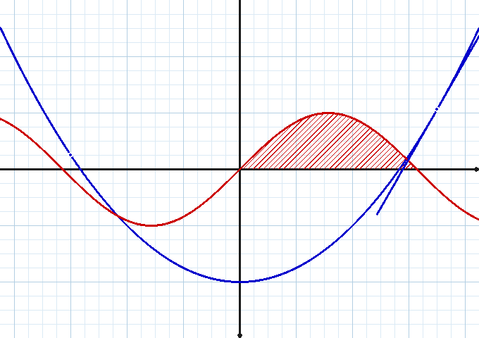

# Sine qua non (Rust)

An **independent, from-scratch Rust rewrite** of the core of the curve plotter
**Sine qua non** — the historical French (Delphi) software created by
**Patrice Rabiller** in 2004 and co-written by **Patrick Pradeau** since 2010,
built for mathematics teachers and their students.

> This repository is not the original project: it is a brand-new program
> written from zero (no Delphi code reused). The original Sine qua non is
> still downloadable from
> [Patrice Rabiller's website](http://www.patrice-rabiller.fr/SineQuaNon/menusqn.htm).

**Readme en français : [README.md](README.md)**



## v0.4 status — statistics: data series at one variable (module v0.4)

The **statistics** module (single-variable data series) is ported, with the
rendering tuned against the figures of the original v2.9.4 manual
(histogram, frequency polygon, box plot, bar chart, Henry line).

| Included | Details |
|---|---|
| Series | histogram of classes (area ∝ frequency), cumulative frequency polygon, box plot (± quartiles/deciles), bar chart, Henry line (probability law) |
| Rendering | legend « 🟩 = 1,0 % », **dashed** grid of minor squares 5 × 5 mm, grey axis numbers, ticks crossing the axis, quartile chutes, numbered French values |
| Interface | statistics window (bilingual FR/EN), Calculs panel (n°, total) |

**Not yet included** (roadmap, one release per module) :
weighted trees, sequences, extrema/zeros, LaTeX expressions, BMP/GIF/EMF/EPS
exports, Bézier curves, printing, preferences.

## v0.5 status — probability: probability laws (module v0.5)

The **probability** module is ported: probability laws (normal, binomial,
Poisson, exponential) are modelled with their density (pdf) and cumulative
distribution (cdf) functions, and the "Probability law" style traces the
density on its own axis (default law: normal fitted on the data, like the
Henry line).

| Included | Details |
|---|---|
| Laws | normal (μ, σ), binomial (n, p), Poisson (λ), exponential (λ) — pdf/cdf, P(X = k) |
| Rendering | density curve normalized to its peak + legend "Law … : μ = …, σ = …" |
| Interface | "Probability law" style (statistics window), Calculs panel |

## v0.9 status — probability trees (module v0.9)

The weighted-tree module (manual p. 62–64) is ported: the code / name /
probability grid, levels of equal width, terminals spread evenly, Ω at
the root, « no grid ».

| Included | Details |
|---|---|
| Data | branch list `BrancheArbre { code, nom, proba }` (code 3× = 1st level, 32 = 2nd branch issued from 3, 341 = 1st issued from 34…) |
| Names | free text; `&` prefix = horizontal bar above the name (Ā) |
| Probabilities | decimal number or any text (0.5 ; p ; 1 p) |
| Layout | levels of equal width across the page, terminals sorted alphabetically, equal vertical spacing, parents = mean of children, root = mean of level 1 |
| Options | Ω (universe of us), « Effacer la grille et les axes » (checked by default = opaque full-page background), colour, thickness |
| Interface | « Probability trees » side-panel section + editor (code/name/probability grid, manual example, levels/leaves preview) |

## v0.8 status — 2-variable statistics (module v0.8)

The scatter plot / regression module (manual p. 52–54) is ported: the
couple table (xᵢ, yᵢ, nᵢ), 8 regression kinds, variable roles and the
Calculs panel (covariance, correlation, corrected correlation).

| Included | Details |
|---|---|
| Data | weighted couples (xᵢ, yᵢ, nᵢ — count 1 by default) |
| Regressions | linear, logarithmic, exponential, power, Mayer (adjustable k), degree-2–4 polynomials, « no curve » |
| Variable | roles y = f(x) / x = f(y) |
| Calculus | weighted moments (x̄, ȳ, σx, σy), covariance, linear r, corrected r per nature |
| Rendering | scatter (red disks, page coordinate system) + coloured curve + French-formatted equation caption |
| Interface | « 2-var. series » side-panel section + full editor |

## v0.7 status — numeric sequences, full parity (module v0.7)

The **numeric sequences** module reaches parity with the original (manual
p. 75–76): sequences `u_n = f(n)` (staircase) and recurrence sequences
`u_{n+1} = f(u_n)` (spider web) are entered **using the variable x** as in
the original, with adjustable first index and first term.

| Included | Details |
|---|---|
| Sequences | `u_n = f(n)` (explicit) and `u_{n+1} = f(u_n)` (recurrence) |
| Variables | `x` (original syntax); v0.6 `n`/`u` still accepted |
| Settings | first index n₀ and first term u₀ (default 0, as in the original) |
| Rendering | staircase (explicit); spider web: `y = x` diagonal, `y = f(x)` curve, cobweb — in the page's coordinate system |
| Interface | « Suites » side-panel section: add, edit, hide, delete |

## v0.3 status — sign and variation tables

| Included | Details |
|---|---|
| Curves | functions `y = f(x)`, parametric curves, polar curves |
| Axes | arbitrary origin, unit in mm, linear **or logarithmic** scales |
| Grid | **5 × 5 mm** minor squares like the original, page up to A0 |
| Points | placed on any curve (function, parametric, polar) with displayed coordinates |
| Tangents | at a point of a function — numeric derivative (central differences), displayed `y = mx + p` equation |
| Integrals | **hatched** areas between the curve and the x-axis, displayed `∫ ≈` value (trapezoid rule) |
| **Tables** | **text code faithful to the original**: cells `[a:b:c]`, separators `|` `\|\|` `\|0` `0`, single-bar fallback, arrows `/:>` `\:>` `_>`, hatching `//`, macros `\infty` `\sqrt{}` `\frac{a}{b}` `\array{}` `\text{}` `\left\|` — rendered with bars **per row**, zeros **on** the bars, values **centred on** the boundaries, stretched arrows with clearance; the original's 10 examples included (`Var1…Var8`, `Sgn`, `Abs`) |
| **Generator** | **“⚡ From a curve”**: zeros of f′ by scanning + bisection, signs, f values at critical points and endpoints, arrows — generated code remains **editable** |
| Interface | graphical (egui), **bilingual English / French** (selector, persisted), wheel = zoom, drag = pan, auto-saved session (curves + language + annotations **+ tables**) |
| Export | **SVG** (mm, printable 1:1, vector labels and hatching) and **PNG** (hatching, markers, bitmap text) — tables included |
| Analysis | calculator syntax, implicit multiplication (`2x`, `3sin(x)`), asymptote clipping |

**Not yet included** (roadmap, one module per release): weighted
probability trees, sequences, extrema/zeros, LaTeX expressions,
BMP/GIF/EMF/EPS export, Bézier curves, printing, global preferences.

## Installation

### Linux — any distribution (one line)

```bash
curl -fsSL https://raw.githubusercontent.com/devfrp/sinequanon/main/install.sh | bash
```

- The **gnu** build (dynamic glibc linking) is installed first: the graphical
  interface works (wayland/GL loaded dynamically); the **static musl** binary
  is a fallback, with an opt-in `--static` flag for servers/containers
  (CLI only — a 100% static binary cannot load the graphics libraries).
- SHA-256 checksum verified automatically; installs into `/usr/local/bin`
  (or `~/.local/bin` without root).
- **Public** repository: no token needed. On a private mirror, prefix the
  `curl` with `GITHUB_TOKEN=…` (or run `gh auth login`).
- Alternatives: `curl … | bash -s -- --bin-dir ~/bin`, `--version v0.2.0`
  or `--static`.

> If the `raw.githubusercontent.com` CDN serves you a stale script (rare but
> seen), bypass it:
> `curl -fsSL -H "Accept: application/vnd.github.raw" https://api.github.com/repos/devfrp/sinequanon/contents/install.sh | bash`

### Windows — `.exe`

Download `sinequanon-windows-x86_64.exe` from the
[Releases](https://github.com/devfrp/sinequanon/releases) page (MSVC build
automated by GitHub Actions).

### macOS — universal binary

Download `sinequanon-macos-universal.tar.gz` (arm64 + x86_64 merged via
`lipo`), then:

```bash
tar -xzf sinequanon-macos-universal.tar.gz && xattr -d com.apple.quarantine sinequanon 2>/dev/null; ./sinequanon
```

### From source

```bash
cargo build --release     # ~8 min; then target/release/sinequanon
cargo test                # 44 tests
```

## Usage

```bash
sinequanon                          # graphical interface
sinequanon --lang en                # graphical interface in English
sinequanon export -f "sin(x)" -f "x^2/4-2" --svg curve.svg
sinequanon export -p "2+cos(theta)" --png curve.png --px-par-mm 6
sinequanon export -c "cos(t);sin(t)/2" --t-min -6.28 --t-max 6.28
sinequanon export -f "log(x)" --log-x --png log.png
sinequanon export -f "x^2" --aire 0:0:2 --tangente 0:2 --point 0:1 --svg tp.svg
sinequanon --aide
```

- `--point C:x`: point on curve #`C` at abscissa `x` (or at parameter
  `t`/`θ` for parametric/polar curves);
- `--tangente C:x`: tangent to function #`C` at `x`;
- `--aire C:a:b`: hatched integral of function #`C` between `a` and `b`.

(Options are French for historical parity with the original software;
`aire` = *area*, `tangente` = *tangent*, `point` = *point*.)

Expression syntax: `+ - * / ^`, functions `sin cos tan asin acos atan
atan2 sinh cosh tanh exp ln log log2 sqrt abs floor ceil round sign min max
mod pow`, constants `pi` (or `π`) and `e`, variables `x` (function), `t`
(parametric), `theta` (or `θ`, polar). Implicit multiplication accepted.

## Continuous integration (GitHub Actions)

The workflow [`.github/workflows/build.yml`](.github/workflows/build.yml):

1. **tests** — `cargo fmt --check`, `cargo clippy -D warnings`, `cargo test` on every push to `main`;
2. **builds** — on `v*` tags or manual dispatch (`workflow_dispatch`):
   - Windows `x86_64-pc-windows-msvc` → **`sinequanon-windows-x86_64.exe`**,
   - macOS arm64 + x86_64 → **`sinequanon-macos-universal.tar.gz`** (via `lipo`),
   - Linux `x86_64` **gnu** (GUI) and **static musl** (CLI), `aarch64` gnu and musl (via `cross`, non-blocking);
3. **release** — on `v*` tags: GitHub Release publication with all files
   + `SHA256SUMS`.

```bash
gh workflow run build                 # manual build
git tag v0.2.0 && git push --tags     # automatic build + release
```

## Architecture

- **100% Rust** (`#![forbid(unsafe_code)]`): [egui/eframe](https://github.com/emilk/egui) interface,
  expression parser/evaluator, adaptive sampling, Liang-Barsky clipping,
  PNG encoder (stored-deflate blocks) and SVG generator all written from
  scratch — zero compiled C dependencies.
- `src/expr.rs` parser/evaluator · `src/grid.rs` mm axes ·
  `src/curve.rs` curves + line styles · `src/annot.rs` points/tangents/
  integrals (central derivative, trapezoids, hatching) · `src/tableau.rs`
  sign/variation tables (original grammar) · `src/tabgen.rs` generator
  from a curve · `src/render.rs` SVG/PNG ·
  `src/png.rs` raster + encoder + 5×7 bitmap font · `src/i18n.rs` bilingual
  strings · `src/app.rs` interface · `src/session.rs` JSON session.

## Roadmap (option-by-option parity with the original 2.9.4)

- ✅ v0.1 — plotting core: curves, axes, 5 × 5 mm grid, SVG/PNG, session
- ✅ v0.2 — graphical module: points, tangents, hatched integrals + bilingual interface
- ✅ v0.3 — sign and variation tables (original's text code) + generation from a curve
- ✅ v0.4 — statistics (module v0.4): data series at one variable (histogram
  of classes, cumulative frequency polygon, box plot, bar chart, Henry line) —
  rendering compared against the manual's figures
- ✅ v0.5 — probability (module v0.5): probability laws (normal, binomial,
  Poisson, exponential) + rendering (style "Probability law")
- ✅ v0.6 — numeric sequences (module v0.6): explicit sequences `u_n = f(n)`
  (staircase) and recurrence sequences `u_{n+1} = f(u_n)` (spider web)
- ✅ v0.7 — sequences v2: full parity (variable `x`, first index n₀,
  first term u₀, true spider web in the coordinate system, GUI editor)
- ✅ v0.8 — 2-variable statistics (module v0.8): scatter plots, 8 regressions
  (weighted least squares, Mayer, polynomials *), y/x roles, covariance,
  correlation + corrected correlation
## v1.1 status — Calculs: equation solver + extrema (solve module)

The « Calculs » menu (solving part, manual p. 95-96) is ported:
numerical equation solving and local extrema.

| Included | Details |
|---|---|
| Solver | sweep + dichotomy (80 iterations, ≈1e-12 relative precision) |
| Equations | f(x) = g(x) between two of the 10 functions, or f(x) = 0 (zeros) |
| Extrema | numeric-derivative zeros (central differences), nature from the second derivative (minimum / maximum) |
| Values | displayed in the « Résoudre une équation… » window (x ≈ …, y ≈ …) |
| Sheet | « mark the points on the sheet » option: solutions / extrema become point annotations (persisted in the session) — the original's « graphical interpretation » |
| Interval | draggable bounds, initialised from the page's visible range |

## v1.0 status — statistical simulations (simu module)

The simulations module (manual p. 65–74) is ported: 7 models,
4 chart types, automatic scaling, theoretical curves and fluctuation.

| Included | Details |
|---|---|
| Models | discrete uniform [min;max], continuous uniform, Bernoulli (p), binomial B(n;p), geometric (first success), Poisson (λ), normal (μ;σ) |
| Generator | dependency-free xorshift64* (no `rand`): seed 0 = neutral seed, draws are replayed bit-exact at export time |
| Size / count | up to 1,000 samples of 10,000 draws (panel bounds) |
| Charts | points (mean fluctuation), histograms (one band per sample), pooled histogram, box plots (one per sample) |
| Discrete bars | one bar per value for discrete laws (die: 6 bars, Bernoulli: 2 bars); class spread applies to continuous laws only (man. p. 67–68) |
| Theoretical | mean line (points), theoretical count (histograms, 50/6 for a die), density curve (pooled) |
| Fluctuation | mean ± 1.96 √(p(1−p)/n) at 95% (Bernoulli only, man. p. 71) |
| Auto scale | the « Lancer » button re-seeds (clock) and fits both axes from the chart's range |
| Panel | pooled grid: count, mean, standard deviation, min, max over all draws |

- ✅ v0.9 — probability trees (module v0.9): code/name/probability grid
  (& prefix = bar), levels of equal width + evenly spread terminals,
  Ω at the root, « no grid »
- ✅ v1.0 — statistical simulations (simu module): 7 probability models,
  4 charts (points / histograms / pooled histogram / boxes), one bar per
  value for discrete laws, automatic scaling, theoretical curve, mean
  fluctuation at 95%, seed-replayed identical draws
  (The original « Séries ordonnées » checkbox only sorts the on-screen
  data grid — no exported rendering — and is not ported.)
- ✅ v1.1 — Calculs: approximate equation solving (f = g or f = 0,
  dichotomy) + automatic local extrema, points marked on the sheet
  (The value tables and the rectangle / trapezoid integration methods
  of the Calculs menu (man. p. 96-99) are still to be ported.)
- ⬜ value tables + integration (methods, bounds)
- ⬜ BMP/GIF/EMF/EPS/LaTeX exports, Bézier curves, preferences, printing

## Credits and license

- Rust code: independent project under the **MIT** license ([LICENSE](LICENSE)).
- Credit for the concept: **Patrice Rabiller** and **Patrick Pradeau** for
  [Sine qua non](http://www.patrice-rabiller.fr/SineQuaNon/menusqn.htm)
  (freeware, Delphi sources published in 2010). Thanks to them for the idea,
  the implicit specification and the 5 × 5 mm grid.
