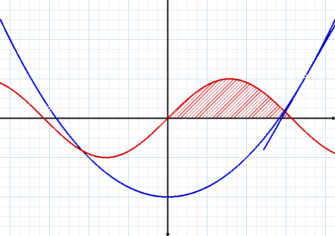

# Sine qua non (Rust)

Réécriture **indépendante et intégrale en Rust** du cœur du traceur de courbes
**Sine qua non** — logiciel français historique (Delphi) créé par
**Patrice Rabiller** en 2004, co-écrit par **Patrick Pradeau** depuis 2010,
destiné aux professeurs de mathématiques et à leurs élèves.

> Ce dépôt n'est pas le projet original : c'est un nouveau programme écrit
> à partir de zéro (aucune ligne de code Delphi réutilisée). Le Sine qua non
> original reste téléchargeable sur le
> [site de Patrice Rabiller](http://www.patrice-rabiller.fr/SineQuaNon/menusqn.htm).

**README en anglais : [README.en.md](README.en.md)**



## État v0.4 — statistiques : série à une variable (module v0.4)

Le module **statistiques** (données à une variable) est porté, avec le
rendu repassé en option sur les captures des figures du manuel v2.9.4
(histogramme, polygone des effectifs, boîte à moustaches, diagramme en
bâtons, droite de Henry).

| Inclus | Détail |
|---|---|
| Série | histogramme en classes (aire ∝ effectif), polygone des effectifs cumulées, boîte à moustaches (± quartiles/déciles), diagramme en bâtons, droite de Henry (loi de probabilité) |
| Rendu | légende « 🟩 = 1,0 % », grille **pointillée** de petits carreaux 5 × 5 mm, chiffres d'axes gris, ticks qui traversent l'axe, chutes aux quartiles, valeurs numérotées français |
| Interface | fenêtre « Statistiques à une variable » bilingue FR/EN, panneau Calculs (n°, Total) |

**Pas encore inclus** (feuille de route, une release par module) :
arbres pondérés, suites, extrema/zéros, expressions LaTeX, export
BMP/GIF/EMF/EPS, courbes de Bézier, impression, préférences globales.

## État v0.5 — probabilités : lois de probabilité (module v0.5)

Le module **probabilités** est porté : les lois de probabilité (normale,
binomiale, Poisson, exponentielle) se modélisent par leurs fonctions de
densité (pdf) et de distribution (cdf), et le style « Loi de probabilité »
trace la densité sur l'axe des valeurs (loi par défaut : normale ajustée
sur les données, comme la droite de Henry).

| Inclus | Détail |
|---|---|
| Lois | normale (μ, σ), binomiale (n, p), Poisson (λ), exponentielle (λ) — pdf/cdf, P(X = k) |
| Rendu | courbe de densité normalisée au pic + légende « Loi … : μ = …, σ = … » |
| Interface | style « Loi de probabilité » (fenêtre Statistiques), panneau Calculs |

## État v0.9 — arbres de probabilités (module v0.9)

Le module arbres pondérés (manuel p. 62–64) est porté : grille
code / nom / probabilité, niveaux à largeur égale, terminaux répartis
à hauteur égale, Ω au pied, « sans grille ».

| Inclus | Détail |
|---|---|
| Données | liste de branches `BrancheArbre { code, nom, proba }` (code 3× = 1ᵉʳ niveau, 32 = 2ᵉ branche issue de 3, 341 = 1ʳᵉ issue de 34…) |
| Noms | texte libre ; préfixe `&` = barre horizontale au-dessus du nom (Ā) |
| Probabilités | nombre décimal ou texte quelconque (0,5 ; p ; 1 p) |
| Layout | niveaux à largeur égale sur la page, terminaux triés alphabétiquement, hauteur répartie également, parents = moyenne des filles, pied = moyenne du niveau 1 |
| Options | Ω (univers des possibles), « effacer la grille et les axes » (cochée par défaut = fond opaque pleine page), couleur, épaisseur |
| Interface | section « Arbres de probabilités » du panneau latéral + éditeur (grille code/nom/proba, exemple du manuel, aperçu niveaux/feuilles) |

## État v0.8 — statistiques à 2 variables (module v0.8)

Le module nuage de points / régressions (manuel p. 52–54) est porté :
table des couples (xᵢ, yᵢ, nᵢ), 8 natures d'ajustement, rôle des
variables et calculs (covariance, corrélation, corrélation corrigée).

| Inclus | Détail |
|---|---|
| Données | couples pondérés (xᵢ, yᵢ, nᵢ — effectif 1 par défaut) |
| Régressions | linéaire, logarithmique, exponentielle, puissance, Mayer (k préréglable), polynômes degré 2–4, « aucune courbe » |
| Variable | rôles y = f(x) / x = f(y) |
| Calculs | moments pondérés (x̄, ȳ, σx, σy), covariance, r linéaire, r corrigé selon la nature |
| Rendu | nuage (disques rouges, repère de la page) + courbe colorée + équation à la française en légende |
| Interface | section « Séries 2 var. » du panneau latéral + éditeur complet |

## État v0.7 — suites numériques à parité complète (module v0.7)

Le module **suites numériques** complète la parité avec l'original
(manuel p. 75–76) : les suites de la forme `u_n = f(n)` (escalier) et
les suites par récurrence `u_{n+1} = f(u_n)` (toile d'araignée) sont
saisies **avec la variable x** comme dans l'original, avec premier indice
et premier terme réglables.

| Inclus | Détail |
|---|---|
| Suites | `u_n = f(n)` (explicite) et `u_{n+1} = f(u_n)` (récurrence) |
| Variables | `x` (syntaxe d'origine) ; `n`/`u` de la v0.6 restent acceptés |
| Réglages | premier indice n₀ et premier terme u₀ (défaut 0, comme l'original) |
| Rendu | escalier (explicite) ; toile d'araignée : diagonale `y = x`, courbe `y = f(x)`, cobweb — dans le repère de la page |
| Interface | section « Suites » du panneau latéral : ajouter, éditer, masquer, supprimer |

## État v0.3 — tableaux de signes et de variations

| Inclus | Détail |
|---|---|
| Courbes | fonctions `y = f(x)`, courbes paramétrées, courbes polaires |
| Repère | origine quelconque, unité en mm, échelles linéaire **ou logarithmique** |
| Grille | petits carreaux **5 × 5 mm** comme l'original, page jusqu'au format A0 |
| Points | placés sur n'importe quelle courbe (fonction, paramétrée, polaire) avec coordonnées affichées |
| Tangentes | en un point d'une fonction — dérivée numérique (différences centrées), équation `y = mx + p` affichée |
| Intégrales | aires **hachurées** entre la courbe et l'axe des abscisses, valeur `∫ ≈` (trapèzes) |
| **Tableaux** | **code texte fidèle à l'original** : cases `[a:b:c]`, séparateurs `|` `||` `|0` `0`, repli barre simple, flèches `/:>` `\:>` `_>`, hachures `//`, macros `\infty` `\sqrt{}` `\frac{a}{b}` `\array{}` `\text{}` `\left|` — rendu avec barres **par rangée**, zéros **sur** les barres, valeurs **centrées sur** les frontières, flèches étirées avec garde ; 10 exemples de l'original inclus (`Var1…Var8`, `Sgn`, `Abs`) |
| **Générateur** | **« ⚡ Depuis une courbe »** : zéros de f′ par balayage + bissection, signes, valeurs de f aux points critiques et aux bornes, flèches — code généré **éditable** dans la fenêtre du tableau |
| Interface | graphique (egui), **bilingue français / anglais** (sélecteur, persisté), molette = zoom, glisser = déplacer, session auto-sauvegardée (courbes + langue + annotations **+ tableaux**) |
| Export | **SVG** (mm, imprimable 1:1, labels et hachures vectoriels) et **PNG** (hachures, marqueurs, texte bitmap) — tableaux inclus |
| Analyse | syntaxe calculatrice, multiplication implicite (`2x`, `3sin(x)`), coupure aux asymptotes |

**Pas encore inclus** (feuille de route, une release par module) :
lois de probabilité (binomiale, normale), arbres pondérés,
suites, extrema/zéros, expressions LaTeX, export BMP/GIF/EMF/EPS,
courbes de Bézier, impression, préférences globales.

## Installation

### Linux — toute distribution (une ligne)

```bash
curl -fsSL https://raw.githubusercontent.com/devfrp/sinequanon/main/install.sh | bash
```

- Priorité au build **gnu** (liaison glibc dynamique) : l'interface graphique
  fonctionne (wayland/GL chargés dynamiquement) ; binaire **musl statique**
  en secours et option `--static` pour serveurs/conteneurs (CLI seulement —
  un binaire 100 % statique ne peut pas charger les bibliothèques graphiques).
- Somme SHA-256 vérifiée automatiquement ; installation dans `/usr/local/bin`
  (ou `~/.local/bin` sans droits root).
- Dépôt **public** : aucun token requis. Sur un miroir privé, ajoutez
  `GITHUB_TOKEN=…` avant le `curl` (ou connectez `gh auth login`).
- Alternatives : `curl … | bash -s -- --bin-dir ~/bin`, `--version v0.2.0`
  ou `--static`.

> Si le CDN de `raw.githubusercontent.com` vous sert un script périmé
> (rare mais vu), contournez-le :
> `curl -fsSL -H "Accept: application/vnd.github.raw" https://api.github.com/repos/devfrp/sinequanon/contents/install.sh | bash`

### Windows — `.exe`

Téléchargez `sinequanon-windows-x86_64.exe` sur la page
[Releases](https://github.com/devfrp/sinequanon/releases) (build MSVC
automatique par GitHub Actions).

### macOS — binaire universel

Téléchargez `sinequanon-macos-universal.tar.gz` (arm64 + x86_64 fusionnés par
`lipo`), puis :

```bash
tar -xzf sinequanon-macos-universal.tar.gz && xattr -d com.apple.quarantine sinequanon 2>/dev/null; ./sinequanon
```

### Depuis les sources

```bash
cargo build --release     # ~8 min ; puis target/release/sinequanon
cargo test                # 44 tests
```

## Utilisation

```bash
sinequanon                          # interface graphique
sinequanon --lang en                # interface graphique en anglais
sinequanon export -f "sin(x)" -f "x^2/4-2" --svg courbe.svg
sinequanon export -p "2+cos(theta)" --png courbe.png --px-par-mm 6
sinequanon export -c "cos(t);sin(t)/2" --t-min -6.28 --t-max 6.28
sinequanon export -f "log(x)" --log-x --png log.png
sinequanon export -f "x^2" --aire 0:0:2 --tangente 0:2 --point 0:1 --svg tp.svg
sinequanon --aide
```

- `--point C:x` : point sur la courbe n° `C` à l'abscisse `x` (ou au
  paramètre `t`/`θ` pour les courbes paramétrées/polaires) ;
- `--tangente C:x` : tangente à la fonction n° `C` en `x` ;
- `--aire C:a:b` : intégrale hachurée de la fonction n° `C` entre `a` et `b`.

Syntaxe des expressions : `+ - * / ^`, fonctions `sin cos tan asin acos atan
atan2 sinh cosh tanh exp ln log log2 sqrt abs floor ceil round sign min max
mod pow`, constantes `pi` (ou `π`) et `e`, variables `x` (fonction), `t`
(paramétrique), `theta` (ou `θ`, polaire). Multiplication implicite acceptée.

## Intégration continue (GitHub Actions)

Le workflow [`.github/workflows/build.yml`](.github/workflows/build.yml) :

1. **tests** — `cargo fmt --check`, `cargo clippy -D warnings`, `cargo test` à chaque push sur `main` ;
2. **builds** — sur tag `v*` ou déclenchement manuel (`workflow_dispatch`) :
   - Windows `x86_64-pc-windows-msvc` → **`sinequanon-windows-x86_64.exe`**,
   - macOS arm64 + x86_64 → **`sinequanon-macos-universal.tar.gz`** (via `lipo`),
   - Linux `x86_64` **gnu** (GUI) et **musl statique** (CLI), `aarch64` gnu et musl (via `cross`, non bloquant) ;
3. **release** — sur tag `v*` : publication GitHub Release avec tous les
   fichiers + `SHA256SUMS`.

```bash
gh workflow run build                 # build manuel
git tag v0.2.0 && git push --tags     # build + release automatiques
```

## Architecture

- **100 % Rust** (`#![forbid(unsafe_code)]`) : interface [egui/eframe](https://github.com/emilk/egui),
  parser/évaluateur d'expressions, échantillonnage adaptatif, découpe
  Liang-Barsky, encodeur PNG (blocs deflate « stored ») et générateur SVG
  écrits maison — zéro dépendance C compilée.
- `src/expr.rs` analyseur/évaluateur · `src/grid.rs` repère mm ·
  `src/curve.rs` courbes + styles de trait · `src/annot.rs` points/tangentes/
  intégrales (dérivée centrée, trapèzes, hachures) · `src/tableau.rs`
  tableaux de signes/variations (grammaire de l'original) · `src/tabgen.rs`
  générateur depuis une courbe · `src/render.rs` SVG/PNG ·
  `src/png.rs` raster + encodeur + police bitmap 5×7 · `src/i18n.rs`
  bilinguisme · `src/app.rs` interface · `src/session.rs` sauvegarde JSON.

## État v1.0 — simulations statistiques (module simu)

Le module simulations (manuel p. 65–74) est porté : 7 modèles,
4 graphiques, échelle automatique, cours théorique et fluctuation.

| Inclus | Détail |
|---|---|
| Modèles | uniforme discrète [min;max], uniforme continue, Bernoulli (p), binomiale B(n;p), géométrique (1ᵉʳ succès), Poisson (λ), normale (μ;σ) |
| Générateur | xorshift64* sans dépendance (sans `rand`) ; graine « 0 » = graine neutre : les tirages sont rejoués à l'identique à l'export |
| Taille / nombre | jusqu'à 1 000 × 10 000 ajustements (bornes du panneau) |
| Graphiques | points (fluctuation des moyennes), histogrammes (une bande par échantillon), histogramme de l'ensemble, boîtes à moustaches (une par échantillon) |
| Barres discrètes | une barre par valeur pour les lois discrètes (dé : 6 barres, Bernoulli : 2 barres) ; la répartition en classes ne s'applique qu'aux lois continues (man. p. 67–68) |
| Théorique | ligne de la moyenne (points), effectif théorique (histogrammes, 50/6 pour un dé), courbe de densité (ensemble) |
| Fluctuation | mean +/- 1,96 √(p(1−p)/n) à 95 % (Bernoulli uniquement, man. p. 71) |
| Échelle auto | le bouton « Lancer » resème (horloge) et règle l'échelle des 2 axes du repère depuis la plage du graphique |
| Panneau | grille générale : effectif, moyenne, écart type, min, max sur l'ensemble des tirages |

## État v1.1 — calculs : solveur + extrema (module solve)

Le menu « Calculs » (partie résolution, man. p. 95-96) est porté :
résolution approchée d'équations et extrema locaux.

| Inclus | Détail |
|---|---|
| Solveur | balayage (1 échantillon ≈ tous les 2,5 ‰ de l'intervalle) + dichotomie (80 itérations, précision ≈ 1e-12 relatif) |
| Équations | f(x) = g(x) entre deux des 10 fonctions, ou f(x) = 0 (zéros) |
| Extrema | annulations de la dérivée numérique (différences centrées), nature par dérivée seconde (minimum / maximum) |
| Valeurs | affichées dans la fenêtre « Résoudre une équation… » (x ≈ …, y ≈ …) |
| Feuille | option « marquer les points sur la feuille » : les solutions/extrema deviennent des annotations points (persistées dans la session) — l'« interprétation graphique » de l'original |
| Interval | bornes draggables, initialisées à la plage visible de la page |

## État v1.2 — graphiques : BMP, GIF et EPS (écran p. 99-101)

Le sous-menu graphique de l'original comporte BMP/GIF/EPS en plus de
SVG : les trois sont portés, avec le même raster que le PNG.

| Inclus | Détail |
|---|---|
| BMP | Windows 24 bits (BGR, rangées bas-haut, padding 32 bits) — raster identique au PNG à l'octet près |
| GIF | GIF89a 256 couleurs : palette « web » 6-6-6 (216) + 32 gris, compression LZW standard (codes 9-12 bits, CLEAR/END) — quantification locale ≤ 51 par canal |
| EPS | EPS niveau 2 avec l'image rasterisée intégrée (ASCIIHexDecode, carré unitaire mis à l'échelle, ImageMatrix [w 0 0 -h 0 h]) — importable tel quel dans LaTeX via \includegraphics |
| Interface | boutons BMP/GIF/EPS de la section export + options CLI --bmp/--gif/--eps |
| Non porté | JPG, EMF/WMF (formats binaires Windows) ; l'EPS de l'original est un PostScript niveau 2 — ici l'image complète est intégrée (nota : pas de tracé vectoriel) |

## État v1.3 — Schéma (socle), préférences et impression PDF (man. p. 89-102, 27-44)

Premier jalon du module Schéma : points nommés et courbes de Bézier,
plus les réglages par défaut et l'impression.

| Inclus | Détail |
|---|---|
| Points du schéma | nom + (x, y), croix + nom italique sur la feuille ; saisie dans la fenêtre « Point du schéma » (le déplacement à la souris de l'original n'est pas porté) |
| Courbes de Bézier | 4 points de contrôle nommés, tangentes (AB) en A et (CD) en D, 80 échantillons Bernstein ; points manquants → rien ne se dessine (comme l'original, les points existent avant la courbe) |
| Préférences | fenêtre réglages repère + mise en page, enregistrées dans `Preferences_sqn.txt` (dossier personnel) au format exact du manuel p. 90 (`Orientation :Portrait`, décimales françaises acceptées…) ; le bouton « Nouveau dessin » applique la page des préférences |
| Impression | export PDF A4 1.4 : raster posé à l'échelle 1:1 (1 mm = 2,8346 pt) sous les marges gauche/haute des préférences, orientation portrait/paysage — bouton « PDF (sinequanon.pdf) » + option CLI `--pdf` |
| Non porté | le reste du Schéma : segments, vecteurs, droites, cercles, ellipses, polygones, angles, zones coloriées, coniques, textes/LaTeX ; drag souris des points ; couleurs/polices des préférences sont conservées dans le fichier mais non câblées au rendu |

## État v1.4 — Calculs : table de valeurs et intégration (man. p. 96-99)

| Inclus | Détail |
|---|---|
| Table de valeurs | menu Calculs ; mode automatique (première valeur + pas) ou manuel (expressions constantes acceptées : « 3/4 », « pi », « sqrt(2) ») ; défilement d'une ligne par ◀▶ ; 10 lignes affichées comme l'original |
| Fractions | bouton : les valeurs rationnelles s'affichent en fractions (dénominateur ≤ 24), sinon décimales tronquées à 6 |
| Courbes visées | fonctions (x, y) et courbes paramétrées (t, x, y) ; les polaires sont refusées, comme dans l'original |
| Copie | bouton « Copier » : table tabulée dans le presse-papier (en-têtes + valeurs) |
| Dessin | bouton : la table se dessine sur la feuille (fond opaque, titre gras, en-têtes italiques), position en mm éditables ; exportée dans tous les formats (SVG, PNG, BMP, GIF, EPS, PDF) et posée après les simulations, avant le schéma |
| Intégration | menu Calculs ; rectangles (gauche, droite, points-milieux) ou trapèzes, n subdivisions (1..500), valeur approchée + encadrement inscrit/exinscrit ; la fenêtre redonne les bornes du repère ouvert |
| Session | le sauvegarde automatique de l'interface restaure désormais TOUT l'état (séries 2, arbres, simulations, schéma et tables, qui se perdaient depuis la v1.0) |
| Nota | l'affichage graphique d'aire hachurée sous une courbe existe déjà via « Annotations/Intégrales » (module graphique) ; l'intégration numérique complète le menu par la valeur + l'encadrement |

## Feuille de route (parité option par option avec l'original 2.9.4)

- ✅ v0.1 — cœur traceur : courbes, repère, grille 5 × 5 mm, SVG/PNG, session
- ✅ v0.2 — module graphique : points, tangentes, intégrales hachurées + interface bilingue
- ✅ v0.3 — tableaux de signes et de variations (code de l'original) + génération depuis une courbe
- ✅ v0.4 — statistiques (module v0.4) : série à une variable (histogramme en
  classes, polygone des effectifs, boîte à moustaches, diagramme en bâtons,
  droite de Henry) — rendu comparé aux figures du manuel v2.9.4
- ✅ v0.5 — probabilités (module v0.5) : lois de probabilité (normale,
  binomiale, Poisson, exponentielle) + visualisation (style « Loi de
  probabilité »)
- ✅ v0.6 — suites numériques (module v0.6) : suites explicites `u_n = f(n)`
  (escalier) et récurrentes `u_{n+1} = f(u_n)` (toile d'araignée)
- ✅ v0.7 — suites v2 : parité complète (variable `x`, premier indice n₀,
  premier terme u₀, vraie toile d'araignée dans le repère, éditeur GUI)
- ✅ v0.8 — statistiques à 2 variables (module v0.8) : nuage de points,
  8 régressions (moindres carrés pondérés, Mayer, polynômes *), rôles y/x,
  covariance, corrélation + corrélation corrigée
- ✅ v0.9 — arbres de probabilités (module v0.9) : grille code/nom/probabilité
  (préfixe & = barre), niveaux à largeur égale + terminaux à hauteur égale,
  Ω au pied, « sans grille »
- ✅ v1.0 — simulations statistiques (module simu) : 7 modèles probabilistes,
  4 graphiques (points / histogrammes / histogramme de l'ensemble / boîtes),
  barres par valeur pour les lois discrètes, échelle automatique, courbe
  théorique, fluctuation des moyennes à 95 %, graine rejouée à l'identique
  (Le bouton « Séries ordonnées » de l'original ne concerne que la grille
  de données du GUI — aucun rendu exporté — et n'est pas porté.)
- ✅ v1.1 — calculs : résolution approchée d'équations (f = g ou f = 0,
  dichotomie) + extrema locaux automatiques, marquage sur la feuille
  (La table de valeurs et les méthodes d'intégration par rectangles /
  trapèzes du menu Calculs (man. p. 96-99) restent à porter.)
- ✅ v1.4 — table de valeurs (auto/manuel, fractions, copie, dessin) +
  intégration numérique (4 méthodes, encadrement) au menu Calculs
- ✅ v1.2 — exports BMP 24 bits, GIF 256 couleurs (LZW) et EPS niveau 2
  (image intégrée ASCIIHex — pas vectoriel ; JPG et EMF/WMF non portés)
- ✅ v1.3 — socle Schéma (points nommés + Bézier), Préférences
  (`Preferences_sqn.txt`, format du manuel), impression PDF A4 (`--pdf`)
- ⬜ fin du Schéma : segments/vecteurs/droites/cercles/ellipses/
  polygones/angles/zones/coniques, textes, drag des points

## Crédits et licence

- Code Rust : projet indépendant sous licence **MIT** ([LICENSE](LICENSE)).
- Crédits au concept : **Patrice Rabiller** et **Patrick Pradeau** pour
  [Sine qua non](http://www.patrice-rabiller.fr/SineQuaNon/menusqn.htm)
  (gratuit, sources Delphi 2010 publiées). Merci à eux pour l'idée, le
  cahier des charges implicite et la grille 5 × 5 mm.
