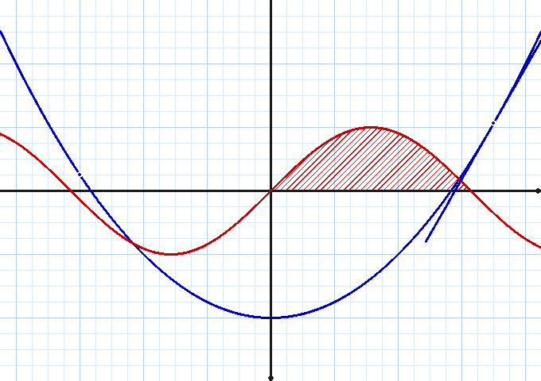

# Sine qua non (Rust)

Réécriture **indépendante et intégrale en Rust** du cœur du traceur de courbes
**Sine qua non** — logiciel français historique (Delphi) créé par
**Patrice Rabiller** en 2004, co-écrit par **Patrick Pradeau** depuis 2010,
destiné aux professeurs de mathématiques et à leurs élèves.

> Ce dépôt n'est pas le projet original : c'est un nouveau programme écrit
> à partir de zéro (aucune ligne de code Delphi réutilisée). Le Sine qua non
> original reste téléchargeable sur le
> [site de Patrice Rabiller](http://www.patrice-rabiller.fr/SineQuaNon/menusqn.htm).



## État v0.1 — le cœur du traceur

| Inclus | Détail |
|---|---|
| Courbes | fonctions `y = f(x)`, courbes paramétrées, courbes polaires |
| Repère | origine quelconque, unité en mm, échelles linéaire **ou logarithmique** |
| Grille | petits carreaux **5 × 5 mm** comme l'original, page jusqu'au format A0 |
| Interface | graphique (egui), French UI, molette = zoom, glisser = déplacer, session auto-sauvegardée |
| Export | **SVG** (mm, imprimable 1:1 avec labels) et **PNG** (raster logiciel maison) |
| Analyse | syntaxe calculatrice, multiplication implicite (`2x`, `3sin(x)`), coupure aux asymptotes |

**Pas encore inclus** (feuille de route) : statistiques, lois de probabilité,
arbres pondérés, intégrales hachurées, tableaux de variation, suites,
points/tangentes/extrema, expressions LaTeX, export BMP/GIF/EMF/EPS,
courbes de Bézier.

## Installation

### Linux — toute distribution (une ligne)

```bash
curl -fsSL https://raw.githubusercontent.com/devfrp/sinequanon/main/install.sh | bash
```

- Priorité au binaire **statique musl** (x86_64 et aarch64) : aucun paquet à installer,
  fonctionne sur Debian, Ubuntu, Fedora, Arch, openSUSE, Alpine, etc.
- Somme SHA-256 vérifiée automatiquement ; installation dans `/usr/local/bin`
  (ou `~/.local/bin` sans droits root).
- **Dépôt privé** : ajoutez `GITHUB_TOKEN=…` avant le `curl` (ou connectez `gh auth login`).
- Alternatives : `curl … | bash -s -- --bin-dir ~/bin` ou `--version v0.1.0`.

### Windows — `.exe`

Téléchargez `sinequanon-windows-x86_64.exe` sur la page
[Releases](https://github.com/devfrp/sinequanon/releases) (build MSVC
automatique par GitHub Actions).

### macOS — binaire universel

Téléchargez `sinequanon-macos-universal.tar.gz` (arm64 + x86_64 fusionnés par
`lipo`), puis :

```bash
tar -xzf sinequanon-macos-universal.tar.gz && xattr -d com.apple.quarantine sinequanon 2>/dev/null; ./sinequanon
```

### Depuis les sources

```bash
cargo build --release     # ~8 min ; puis target/release/sinequanon
cargo test                # 29 tests
```

## Utilisation

```bash
sinequanon                          # interface graphique
sinequanon export -f "sin(x)" -f "x^2/4-2" --svg courbe.svg
sinequanon export -p "2+cos(theta)" --png courbe.png --px-par-mm 6
sinequanon export -c "cos(t);sin(t)/2" --t-min -6.28 --t-max 6.28
sinequanon export -f "log(x)" --log-x --png log.png
sinequanon --aide
```

Syntaxe des expressions : `+ - * / ^`, fonctions `sin cos tan asin acos atan
atan2 sinh cosh tanh exp ln log log2 sqrt abs floor ceil round sign min max
mod pow`, constantes `pi` (ou `π`) et `e`, variables `x` (fonction), `t`
(paramétrique), `theta` (ou `θ`, polaire). Multiplication implicite acceptée.

## Intégration continue (GitHub Actions)

Le workflow [`.github/workflows/build.yml`](.github/workflows/build.yml) :

1. **tests** — `cargo fmt --check`, `cargo clippy -D warnings`, `cargo test` à chaque push sur `main` ;
2. **builds** — sur tag `v*` ou déclenchement manuel (`workflow_dispatch`) :
   - Windows `x86_64-pc-windows-msvc` → **`sinequanon-windows-x86_64.exe`**,
   - macOS arm64 + x86_64 → **`sinequanon-macos-universal.tar.gz`** (via `lipo`),
   - Linux `x86_64` **musl statique** et **gnu**, `aarch64` musl (via `cross`, non bloquant) ;
3. **release** — sur tag `v*` : publication GitHub Release avec tous les
   fichiers + `SHA256SUMS`.

```bash
gh workflow run build                 # build manuel
git tag v0.1.0 && git push --tags     # build + release automatiques
```

## Architecture

- **100 % Rust** (`#![forbid(unsafe_code)]`) : interface [egui/eframe](https://github.com/emilk/egui),
  parser/évaluateur d'expressions, échantillonnage adaptatif, découpe
  Liang-Barsky, encodeur PNG (blocs deflate « stored ») et générateur SVG
  écrits maison — zéro dépendance C compilée.
- `src/expr.rs` analyseur/évaluateur · `src/grid.rs` repère mm ·
  `src/curve.rs` courbes + styles de trait · `src/render.rs` SVG/PNG ·
  `src/png.rs` raster + encodeur · `src/app.rs` interface ·
  `src/session.rs` sauvegarde JSON.

## Crédits et licence

- Code Rust : projet indépendant sous licence **MIT** ([LICENSE](LICENSE)).
- Crédits au concept : **Patrice Rabiller** et **Patrick Pradeau** pour
  [Sine qua non](http://www.patrice-rabiller.fr/SineQuaNon/menusqn.htm)
  (gratuit, sources Delphi 2010 publiées). Merci à eux pour l'idée, le
  cahier des charges implicite et la grille 5 × 5 mm.
